# Control · assistente financeiro por chat (demonstração com dados fictícios)

> Desafio final do bootcamp **Bradesco · Agentes de IA** (DIO), baseado na aula *MCP sem complicação: Open Finance com Pluggy e Sandbox*, de Bruno Lima.
>
> ⚠️ **Todos os dados são fictícios.** A Plaid Sandbox é só um laboratório: ela não representa o Open Finance brasileiro, que em produção exige consentimento, segurança e credenciais próprias.

**Chat no Lovable (entrega da parte 4):** <https://screenshot-to-pixel-perfect-1667.lovable.app>  
**Versão com testes automatizados (GitHub Pages):** <https://brenolrocha22.github.io/control-assistente-financeiro/>  
**Repositório:** <https://github.com/brenolrocha22/control-assistente-financeiro>  
**Stack da versão do repositório:** React 18 + Vite + TypeScript, sem backend e sem credenciais no navegador

---

## 1. Onde o cliente já está e o que o assistente responde

**Cenário:** o chat fica dentro do **app de um banco digital** (marca fictícia *Control*), que é onde o cliente já abre para ver o saldo. Em vez de navegar por telas de extrato, ele pergunta em português:

| Pergunta | O que o Control faz |
| --- | --- |
| "Mostrar minhas contas" | Lista contas, tipo, natureza (depósito/crédito) e moeda |
| "Consultar meus saldos" | Separa **dinheiro disponível**, **dívida nos cartões** e **limite**, sem somar tudo como patrimônio |
| "Ver minhas últimas transações" | Mostra as 5 mais recentes com situação (confirmada/pendente) |
| "Quanto gastei com alimentação?" | Soma só as saídas **confirmadas** da categoria e mostra as pendentes à parte |
| "Resumir minhas movimentações" | **Consumo** separado de **dívidas pagas e transferências** (para não contar a compra no cartão e o pagamento da fatura duas vezes), entradas, pendentes e gráfico de consumo por categoria |
| "Quanto gastei com mercado?" (termo que não existe nos dados) | Avisa que não encontrou e lista as categorias e estabelecimentos válidos, em vez de responder outra coisa |
| "Quanto gastei com Uber?" · "Transações do cartão nos últimos 7 dias" · "Gastos por categoria na conta corrente" | Filtros por **estabelecimento, conta e período** (a melhoria escolhida, ver seção 4) |
| "Faça um Pix…" · "Quanto é isso em reais?" | Recusa com explicação: o app é só leitura e não inventa cotação |

### De onde vem cada dado

```
Pergunta ─► Control (frontend) ─► camada de serviços ─► Dataset ─► motor de respostas ─► tabelas, cartões e gráficos
                                    │
                                    ├─ Etapa 1 (atual): amostra local fictícia  → src/data/sample.ts
                                    └─ Etapa 2 (futura): backend próprio → Plaid Sandbox (/accounts/get, /transactions/get)
```

| Dado no app | Origem |
| --- | --- |
| 4 contas e saldos | Amostra da especificação (guia, p. 26), no mesmo formato da resposta de `/accounts/get` da Plaid |
| 17 transações (01 a 25/09/2026) | Amostra local com descrições e categorias (`personal_finance_category`) no padrão da Plaid Sandbox. **Não é** o conjunto real de 48 transações do ensaio |
| Convenção de sinal | Plaid: **positivo = saída**, negativo = entrada |
| Conceitos (Item, conta, transação, paginação) | Documentação da **Pluggy**, consultada pelo MCP `pluggy` |
| Dados reais de Sandbox (contas, transações, padrões) | MCP `plaid` + API `sandbox.plaid.com`, consultados na IA: First Platypus Bank, 14 contas, 48 transações em 90 dias ([resultado do P07](docs/evidencias/plaid-p07.md)) |

Os totais são **calculados pelo código** ([src/engine/answer.ts](src/engine/answer.ts)), não por um modelo de linguagem. Por isso cada número pode ser rastreado até os registros, e os testes automatizados ([src/engine/answer.test.ts](src/engine/answer.test.ts)) conferem as somas.

---

## 2. Configuração dos servidores MCP

Passo a passo completo, incluindo caminhos para Windows e macOS e os erros comuns: **[docs/mcp-setup.md](docs/mcp-setup.md)**.

Resumo:

| Servidor | Tipo | Configuração |
| --- | --- | --- |
| Pluggy Docs | Streamable HTTP | URL `https://mcp.pluggy.ai/mcp`, sem chave. Já registrado neste repo em [`.mcp.json`](.mcp.json) |
| Plaid Sandbox | STDIO | Comando: caminho absoluto do `uvx`; argumento: `mcp-server-plaid`; variáveis de ambiente `PLAID_CLIENT_ID` e `PLAID_SECRET` (Sandbox). No Windows deste projeto, o `uvx` falhou por causa do limite de tamanho de caminho, e a solução foi `uv tool install` com um cache de caminho curto (ver [docs/mcp-setup.md](docs/mcp-setup.md)) |

```toml
# ~/.codex/config.toml  (fora do repositório; valores abaixo são espaços reservados)
[mcp_servers.plaid]
command = "/caminho/para/uvx"
args = ["mcp-server-plaid"]
startup_timeout_sec = 60

[mcp_servers.plaid.env]
PLAID_CLIENT_ID = "COLE_SEU_CLIENT_ID"
PLAID_SECRET = "COLE_SEU_SANDBOX_SECRET"
```

Os prompts usados nas duas práticas (P01–P09) estão em **[docs/prompts.md](docs/prompts.md)**.

---

## 3. Especificação enviada e ajustes

A base foi a especificação SDD das páginas 25 a 28 do guia, com a marca **Control** no lugar do nome desfocado: **[docs/lovable-spec.md](docs/lovable-spec.md)**. Ela pode ser colada no Lovable como um único pedido.

### No Lovable (como no guia)

A especificação foi enviada primeiro no **modo chat**, para o Lovable tirar dúvidas, e depois construída e publicada: **<https://screenshot-to-pixel-perfect-1667.lovable.app>**.

- **Só a Etapa 1:** o Lovable pediu as chaves da Plaid para avançar à Etapa 2, e elas **não foram fornecidas**. O app roda só com a amostra local, mostra "Modo local, sem conexão bancária" e se declara somente leitura.
- **Mesmos números da versão do repositório:** dinheiro disponível US$ 300,00, dívida nos cartões US$ 5.430,00 e limite US$ 4.980,00.
- **Respostas:** a IA do Lovable interpreta a pergunta, e os números são calculados por código, como a especificação exige.

| Início | Saldos | Últimas transações |
| --- | --- | --- |
| 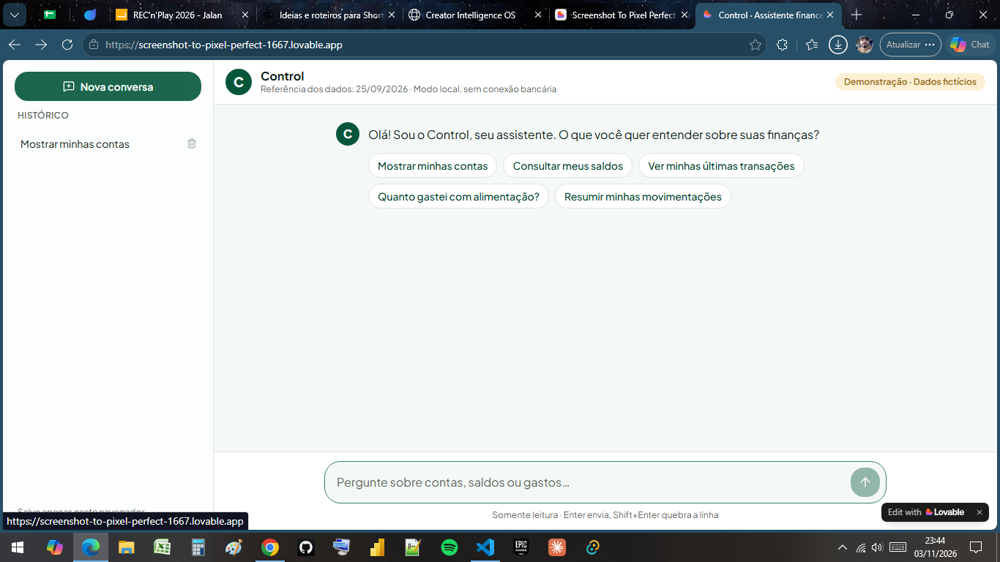 | 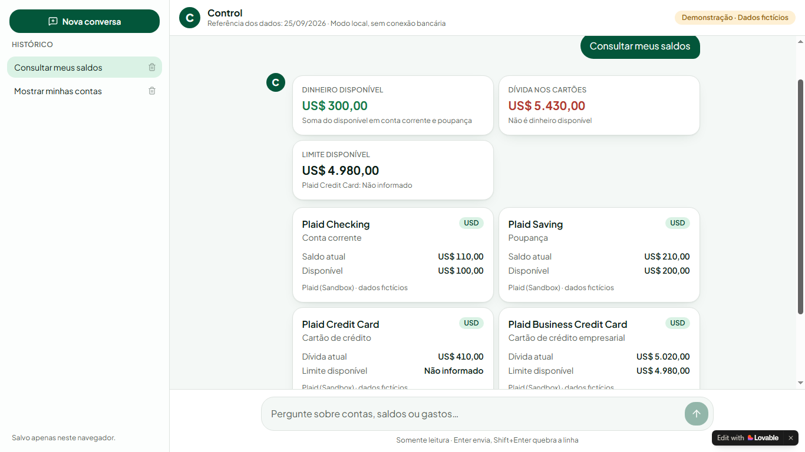 | 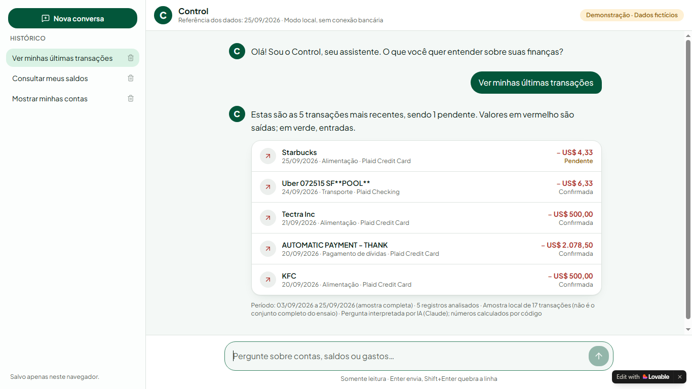 |

### No repositório (Claude Code)

A mesma especificação também foi implementada com o **Claude Code**, com testes automatizados que conferem cada soma. O que foi ajustado ou decidido durante a construção:

- **Respostas calculadas, não geradas:** um roteador de intenções em português chama funções que filtram e somam os registros. Assim, nenhum número é inventado, e perguntas fora do escopo recebem uma explicação com sugestões válidas.
- **Honestidade do modo:** uma faixa fixa mostra "Modo demonstração · dados locais · sem integração ativa com APIs". Nada indica "Conectado".
- **Moeda preservada:** valores em `US$ 1.234,56` (formatação brasileira, moeda original). Pedidos de conversão para reais são recusados enquanto não houver uma cotação declarada.
- **Pendentes fora dos totais:** a transação pendente aparece na tabela, mas não entra nas somas.
- **Celular:** no celular, as tabelas viram cartões empilhados e o histórico vira uma gaveta lateral.
- **Histórico:** as conversas ficam salvas no `localStorage` deste navegador (só mensagens, nunca credenciais). O botão "Nova conversa" inicia outra.
- **Camada de serviços substituível:** [src/services/dataSource.ts](src/services/dataSource.ts) isola a fonte de dados. A Etapa 2 troca só esse arquivo por um backend.

---

## 4. Melhoria escolhida

**Responder perguntas novas: gasto por categoria, estabelecimento, período e conta.**

O motor entende combinações como:

- categorias: alimentação, transporte, viagens, mercadorias, cuidados pessoais, pagamentos de dívidas, transferências, entradas;
- estabelecimentos presentes nos dados: Uber, KFC, Starbucks, United, McDonald's…;
- períodos: hoje, ontem, últimos N dias/semanas, esta semana, este mês, nome do mês, `de 10/09 a 20/09`;
- contas: corrente, poupança, cartão, cartão empresarial.

Se o período pedido estiver fora da amostra, a resposta diz isso e não inventa movimentações.

---

## 5. Como rodar

```bash
npm install
npm run dev      # http://localhost:5173
npm test         # 24 testes do motor de respostas
npm run build    # gera dist/ (site estático)
```

### Publicação

O workflow [.github/workflows/deploy.yml](.github/workflows/deploy.yml) testa, gera o build e publica no **GitHub Pages** a cada push na `main`. Para ativar: *Settings › Pages › Source: GitHub Actions*. O `dist/` também funciona em qualquer host estático (Vercel, Netlify).

---

## 6. Evidências

Lista completa em **[docs/evidencias/](docs/evidencias/)**.

### Conversa no app

| Contas | Gasto com alimentação |
| --- | --- |
| 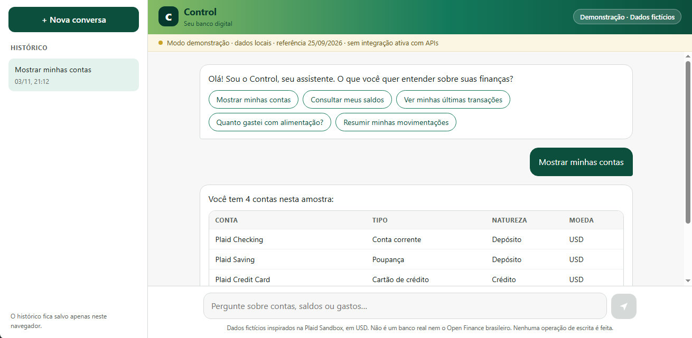 | 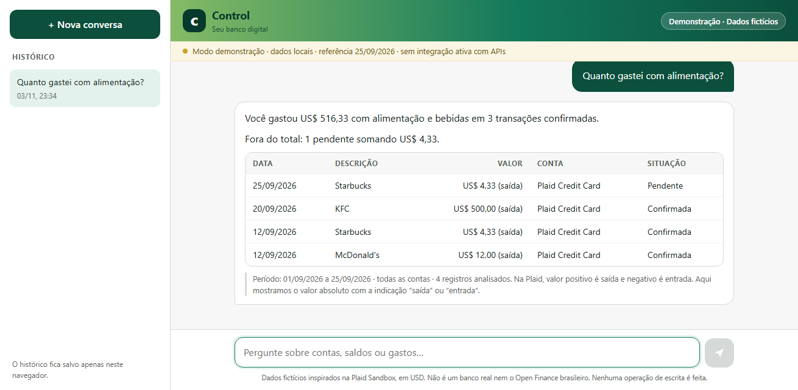 |

| Lista de contas | Últimas transações |
| --- | --- |
| 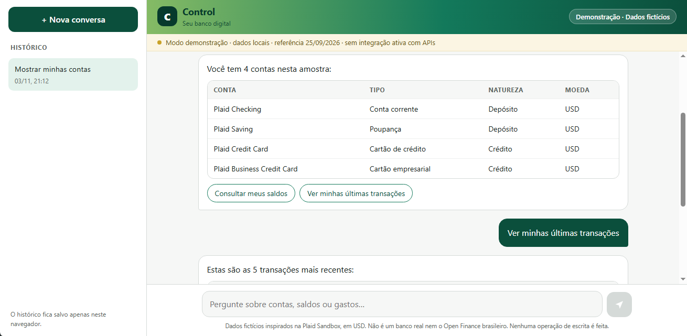 | 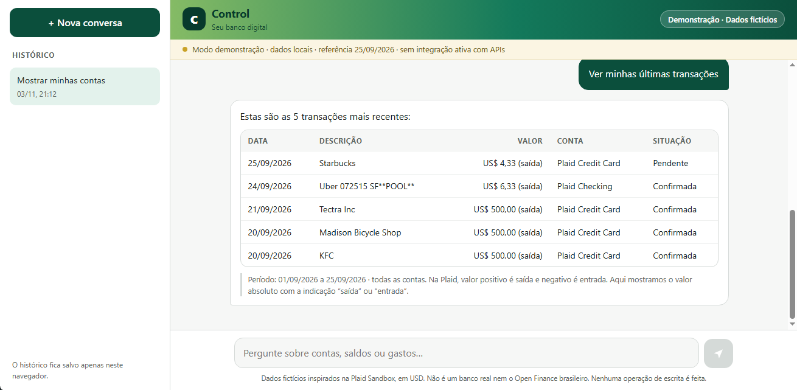 |

### No celular (app publicado, Android)

| Pergunta | Total e pendente | Tabela em cartões |
| --- | --- | --- |
| 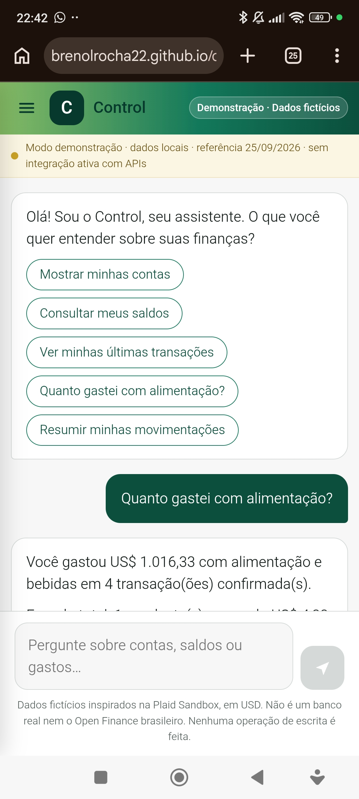 | 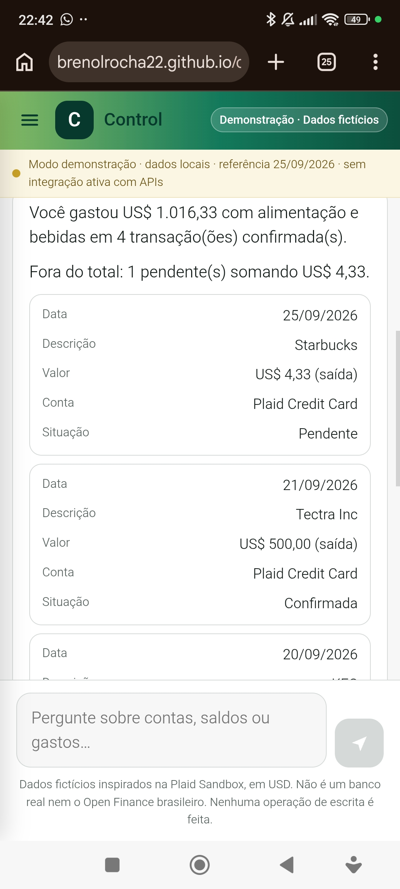 | 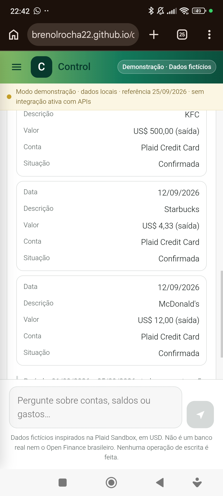 |

| Consumo separado da fatura paga | Termo que não existe nos dados |
| --- | --- |
| 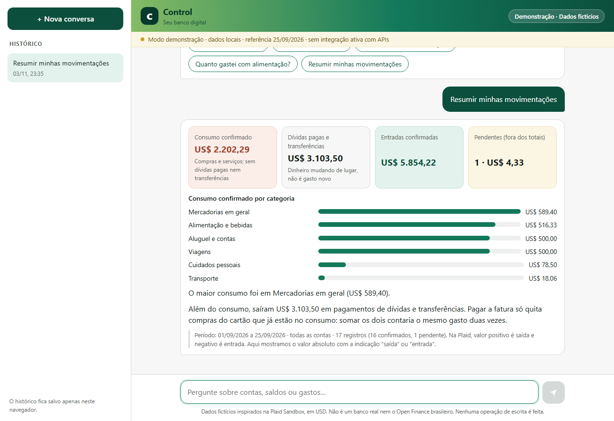 | 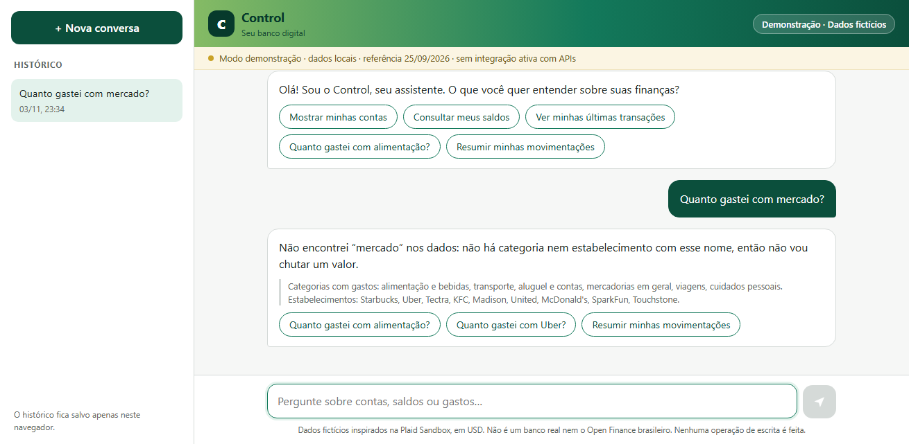 |

### Servidores MCP conectados

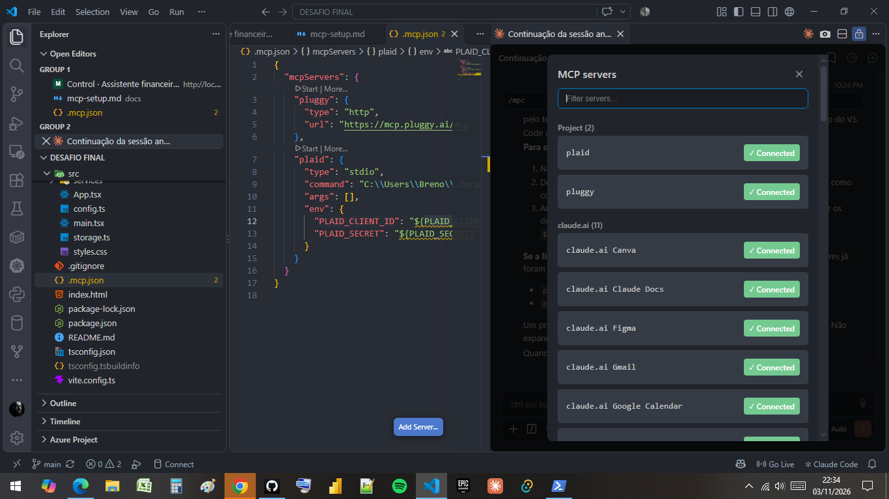

### Pluggy Docs (P01–P02)

O MCP listou os 4 endpoints do grupo Transaction e explicou Item × conta × transação com fontes: **[docs/evidencias/pluggy-p01-p02.md](docs/evidencias/pluggy-p01-p02.md)**.

| P01 · endpoints | P02 · conceitos |
| --- | --- |
| 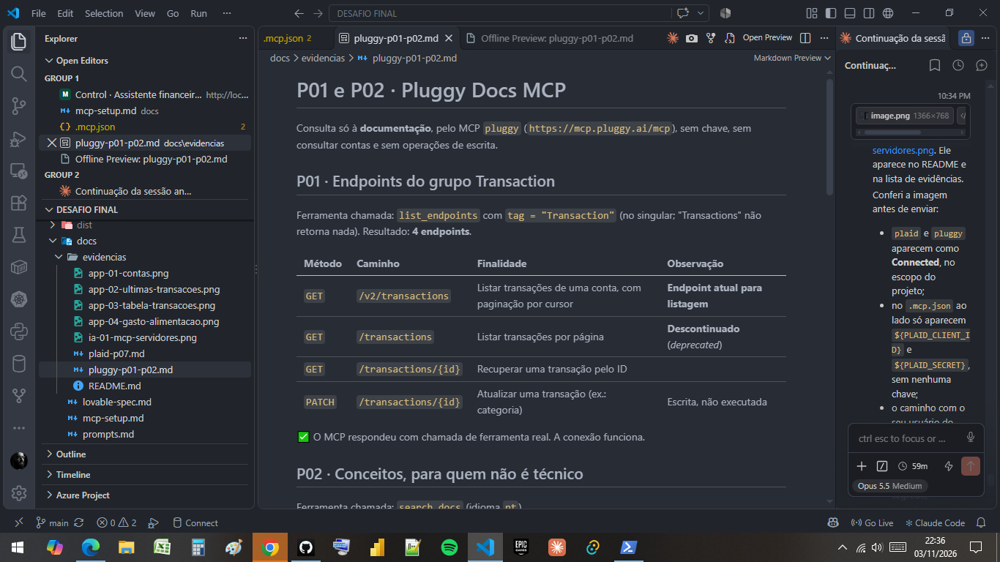 | 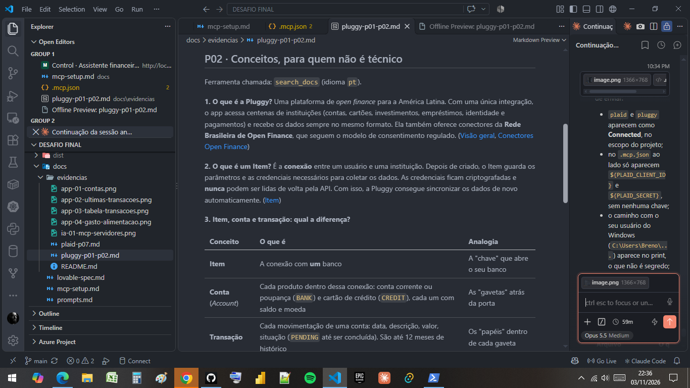 |

### Plaid Sandbox (P05–P07)

O MCP `plaid` criou um Item no **First Platypus Bank** (`ins_109508`). A consulta de 90 dias leu **48/48 transações** com paginação, sem `PRODUCT_NOT_READY`. Contas separadas em dinheiro, dívidas e limites, as 5 transações mais recentes e três padrões de gasto estão em **[docs/evidencias/plaid-p07.md](docs/evidencias/plaid-p07.md)**.

| Dívidas e limites | Padrões de gasto |
| --- | --- |
| 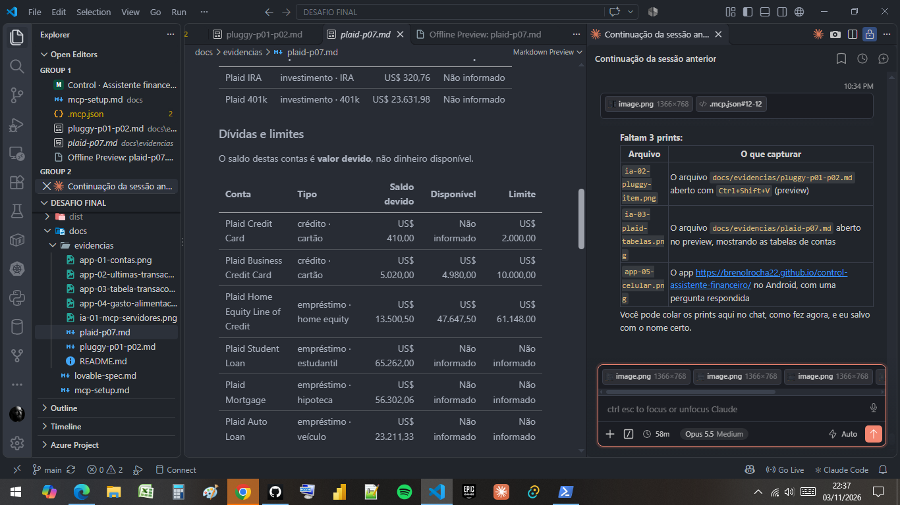 | 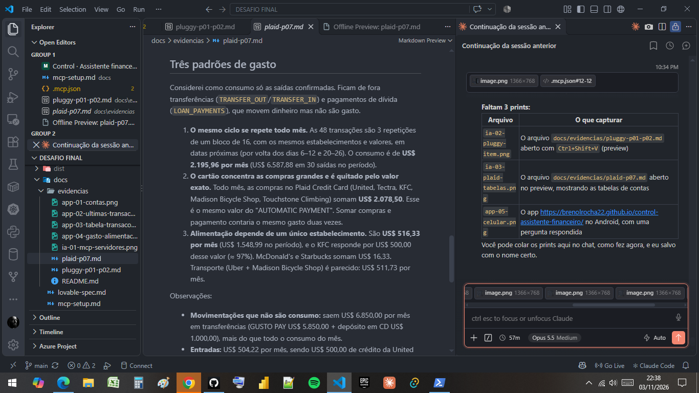 |

Demais telas (resumo, dinheiro, transações, observações) em [docs/evidencias/](docs/evidencias/).

### Conferência

O total de alimentação confere com a amostra: KFC (500,00) + McDonald's (12,00) + Starbucks (4,33) = **US$ 516,33**. A Tectra Inc (US$ 500,00) é **aluguel e contas**, como na consulta real da Plaid (P07), e não entra em alimentação. O Starbucks de 25/09 está pendente e aparece fora da soma.

---

## 7. Segurança

- Nenhuma chave, token ou senha é versionada. O `.gitignore` bloqueia `.env*`, `config.toml` e backups.
- O app não pede credenciais e não faz chamadas de rede para APIs financeiras.
- Na Etapa 2, `PLAID_CLIENT_ID`, `PLAID_SECRET` e `PLAID_ACCESS_TOKEN` ficariam **apenas no backend**.

## Estrutura

```
.mcp.json                  servidor MCP da Pluggy (projeto, sem segredos)
docs/
  mcp-setup.md             configuração Pluggy + Plaid e erros comuns
  prompts.md               prompts P01–P09
  lovable-spec.md          especificação SDD adaptada
  evidencias/              prints
src/
  config.ts                marca e saudação
  data/sample.ts           amostra fictícia (contas e transações)
  engine/answer.ts         roteador de intenções e cálculos
  engine/answer.test.ts    testes dos cálculos
  services/dataSource.ts   camada de dados substituível (Etapa 1 / Etapa 2)
  components/              chat, composer, histórico e blocos
```

## Referências

[Pluggy MCP](https://docs.pluggy.ai/pt/docs/developer-tools/mcp) · [Pluggy: Item](https://docs.pluggy.ai/pt/docs/connections/item) · [Plaid Sandbox](https://plaid.com/docs/sandbox/) · [Plaid MCP](https://github.com/plaid/ai-coding-toolkit/blob/main/sandbox/README.md) · [Plaid Transactions API](https://plaid.com/docs/api/products/transactions/) · [uv](https://docs.astral.sh/uv/getting-started/installation/)
